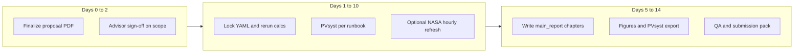

# Two-week completion plan (updated)

**Project title:** Atmospheric Water Harvesting for Autonomous PV Panels Cleaning  

**Case study:** Benban Solar Park (Aswan, Egypt) — representative block; coordinates and data pipelines are already in `project_inputs.yaml` and `scripts/`.

This schedule supersedes earlier drafts: it matches the **current** repo layout (`main_report.tex`, `proposal_short.tex`, `project_calculations.py`, `fetch_nasa_power.py`, `psychrometrics_hourly.py`, `docs/PVsyst_runbook.md`, `submission/SUBMISSION_CHECKLIST.md`).

---

## Ground rules

- **Single source of numbers:** Edit `project_inputs.yaml`, then run `python scripts/project_calculations.py` before compiling `main_report.tex`.
- **Project logic:** Theoretical research and calculations are the **basis for selecting the optimal configuration**; the end goal is a **validated, buildable system design** with simulation, drawings, BOM, and assembly workflow.
- **Scope:** The thesis centers on **AWH + water treatment** sized for **autonomous** (minimally attended) panel cleaning. Full robot mechatronics is optional unless your advisor requires it.
- **Simulation depth:** PVsyst for PV + soiling; Python/CSV for water energy and optional monthly psychrometrics — not mandatory TRNSYS/CFD in two weeks unless you already started.



---

## Days 0–2: Short proposal (deadline: ~3 days from start)

**Deliverable:** `proposal_short.pdf` (source: `proposal_short.tex`).

| Task | Detail |
|------|--------|
| Align title | Already set to *Atmospheric Water Harvesting for Autonomous PV Panels Cleaning*; adjust case-study MW if advisor changes scope. |
| Problem / objectives | Autonomous cleaning water need + arid Egypt + AWH comparison (SEC, LCOW). |
| Methods | Water demand equations; PVsyst; YAML-driven calculations; optional hourly NASA/ERA5. |
| Risks | Illustrative SEC/CAPEX/tariff; soiling without on-site measurements. |
| Submit | PDF + one-page advisor sign-off if required by faculty. |

**End of Day 2:** Email or meeting: confirm Benban block size (e.g. 200 MW DC) and whether robot CAD is in scope.

---

## Days 1–7: Data lock + core simulations

| Day | Focus |
|-----|--------|
| **1** | Freeze `project_inputs.yaml` (`P_dc`, `w`, `N_clean`, `f_margin`, tariff, SEC bands). Run `project_calculations.py`; verify `output/lcow_table_autogen.tex`. |
| **2** | **PVsyst:** Follow `docs/PVsyst_runbook.md` — site near 24.45°N, 32.75°E; grid-connected; **monthly soiling** justified for arid Upper Egypt; export annual yield, PR, loss diagram. |
| **3** | Optional: Soiling sensitivity (±1–2% on worst months). Save exports under `submission/pvsyst_exports/`. |
| **4** | Copy loss figure to `figures/pvsyst_loss_diagram.pdf` (or PNG and update `main_report.tex`). |
| **5** | **NASA POWER:** Run `fetch_nasa_power.py` (or update date range in YAML for another year); run `psychrometrics_hourly.py`; use `output/psychrometrics_monthly.csv` for one seasonal discussion paragraph or plot. |
| **6–7** | Draft report Sections 1–3 in `main_report.tex` (expand introduction, site, methods); paste PVsyst assumptions and results; cross-check abstract vs YAML. |

---

## Selected design basis

- **Numerical minimum LCOW:** `Absorption` from the current YAML-driven comparison.
- **Prototype-selected configuration:** modular `VCR` condensation skid with polishing treatment and storage because it remains close to the economic minimum while being directly buildable.
- **Calculated basis:** `P_dc_MW=200`, `eta_module=0.215`, `w=1.8 L/m2/event`, `N_clean=18/year`, `f_margin=0.25`, `V_year_m3=37674.4`, `m_day_avg_kg=103217.6`.
- **Prototype target:** `200 L/day` condensate, `500 L` raw tank, `500 L` polished tank, discharge pump `2.0 m3/h @ 3.0 bar`.

## Traceability map

| Calculation | Design decision | Output |
|-------------|-----------------|--------|
| PV area and annual water duty | Use modular production plus storage | Tank sizing and daily condensate target |
| LCOW ranking | Keep `Absorption` as benchmark, select `VCR` for build | Prototype route with minimal economic penalty |
| Water quality analysis | Add sediment + carbon + UV polishing | Final rinse-water train |
| Cleaning interface assumptions | Fix pump and manifold duty | `2.0 m3/h @ 3.0 bar` test interface |

## Simulation and prototype package

- **Simulation plan:** hourly NASA POWER/ERA5 weather, PVsyst soiling validation, VCR performance model, and sensitivity cases for summer heat, low-RH nights, fouled filters, and missed cleaning cycles.
- **Drawing package:** `D-101` process flow, `D-102` skid GA, `D-103` tank/drains, `D-104` treatment manifold, `D-105` electrical one-line, `D-106` controls/instrumentation, `D-107` cleaning interface.
- **Prototype BOM:** compressor package, evaporator, condenser, EC fans, two tanks, sediment filter, carbon filter, UV, pump, flow meter, TDS meter, T/RH sensors, level switches, PLC/datalogger, valves, tubing.
- **Build/QC gates:** leak test, electrical isolation, sensor calibration, 24-hour condensate run, TDS verification, and discharge-pressure verification.

---

## Days 8–12: Full report body + integration

| Chapter / area | Action |
|----------------|--------|
| **Introduction** | Tie AWH explicitly to **autonomous** cleaning (water storage, peak flow, quality). |
| **Water demand + AWH** | Numbers from YAML + literature SEC; cite `references.bib` (Kim, PVsyst help, NASA, etc.). |
| **PV results** | Embed PVsyst figure; tabulate key KPIs (kWh/kWp/yr or PR). |
| **Discussion** | Why VCR+polish vs TEC vs sorption for your metrics; limitations. |
| **Conclusions** | Bullet outcomes + future work (prototype SEC, site water tests). |

**Optional:** Pull short passages from standalone TeX files (`project_structure.tex`, `project_analysis_awh_comparison_and_scope.tex`, `project_awh_benban_numbers_cost_quality.tex`) only if your page count needs depth — avoid contradicting `project_inputs.yaml`.

---

## Days 13–14: QA + submission pack

Use `submission/SUBMISSION_CHECKLIST.md` and verify:

- [ ] `main_report.pdf` compiles: `pdflatex` → `bibtex main_report` → `pdflatex` ×2  
- [ ] Abstract matches YAML-driven numbers  
- [ ] `proposal_short.pdf` included  
- [ ] `output/` calculation artifacts + optional `nasa_power_hourly.csv`  
- [ ] PVsyst exports in `submission/pvsyst_exports/`  
- [ ] Faculty cover page / Arabic abstract added if required (manual step)

---

## If time runs short — priority order

1. **Must have:** YAML-consistent water demand + LCOW table + PVsyst base case + written comparison of AWH options.  
2. **Should have:** PVsyst loss figure + monthly soiling justification.  
3. **Nice:** Hourly NASA/psychrometrics plot; extra sensitivity.  
4. **Defer:** Full CFD, full robot CAD, lab MOF build — describe as future work.

---

## Quick build commands (project root)

```text
pip install -r requirements.txt
python scripts/project_calculations.py
python scripts/fetch_nasa_power.py
python scripts/psychrometrics_hourly.py
pdflatex proposal_short.tex
pdflatex main_report.tex
bibtex main_report
pdflatex main_report.tex
pdflatex main_report.tex
```

---

*Last aligned with repo after title edit: Atmospheric Water Harvesting for Autonomous PV Panels Cleaning.*
